<p align="center">
  
</p>

<p align="center">
  <a href="https://www.bahramzada.az"></a>
  <a href="https://linkedin.com/in/bahramzada"></a>
  <a href="https://www.kaggle.com/raullte"></a>
  <a href="mailto:raulbahramzada@gmail.com"></a>
</p>


## 🧑‍💻 About

```python
class RaulBahramzada:
    role      = ["AI Engineer", "Data Scientist"]
    company   = "Kontakt (ABC-Telecom)"
    location  = "Baku, Azerbaijan 🇦🇿"
    focus     = ["LLMs & RAG", "Agentic AI", "Computer Vision", "NLP", "Speech-to-Text", "Automation"]
    education = "M.Sc. Business Organization & Management, UNEC"

    def current_work(self):
        return "Shipping production AI systems that turn raw data into decisions."
```

I build and ship end-to-end intelligent systems: from speech-to-text pipelines and LLM-based evaluation to retrieval-augmented generation, computer vision, and multi-agent orchestration. I care equally about the **model** and the **engineering** around it: FastAPI/Node backends, Postgres + pgvector, background jobs, Docker deployments, and clean, testable code. Outside work I build native Apple apps and small products.

- 🔭 Building production **LLM, RAG, and automation** systems as an AI & Automation Engineer
- 🧠 Deep interest in **agentic AI**, retrieval, and applied **NLP for the Azerbaijani language**
- 🌱 Exploring evaluation/observability for LLM apps and cost-aware inference
- 💬 Ask me about **RAG, LLM pipelines, computer vision, or automation**


## 🛠️ Tech Stack

**Languages**

<p>
  
</p>

**AI / ML & Data**

<p>

<br />


</p>

**Backend, Frontend & Infra**

<p>
  
</p>


## 🚀 Featured Projects

Apps I'm building right now. All are open source and **in development**.

<table>
  <tr>
    <td width="50%" valign="top">
      <h3><a href="https://github.com/bahramzada/orbis">🛰️ Orbis</a></h3>
      
      <p>Agent control room for supervisor-worker AI workflows. A supervisor plans the task, four specialized workers (researcher, strategist, builder, reviewer) execute it in parallel, with live logs, memory, reruns and human-in-the-loop plan review.</p>
      
      
      
      
    </td>
    <td width="50%" valign="top">
      <h3><a href="https://github.com/bahramzada/vps-control">🖥️ VPS Control</a></h3>
      
      <p>Native macOS control center for monitoring and managing VPS servers over SSH. Local-first, public-key only, no stored passwords, with a built-in SSH terminal, security diagnostics and a read-only remote file browser.</p>
      
      
      
      
    </td>
  </tr>
  <tr>
    <td width="50%" valign="top">
      <h3><a href="https://github.com/bahramzada/samovar">🫖 Samovar</a></h3>
      
      <p>A small personal macOS app for playing single-player Windows Steam games on Apple Silicon. A clean native library on top of Wine, with a separate graphics backend per game (D3DMetal, DXMT, DXVK + MoltenVK).</p>
      
      
      
      
    </td>
    <td width="50%" valign="top">
      <h3><a href="https://github.com/bahramzada/minima">🌿 Minima</a></h3>
      
      <p>Azerbaijani micro-habit tracker built around tiny five-minute habits, with mood logging and AI-powered daily tasks. Small steps, big results.</p>
      
      
      
      
    </td>
  </tr>
</table>

### 📚 More Projects

| Project | What it does | Stack |
|---|---|---|
| [🧩 **MoveMind**](https://github.com/bahramzada/movemind) | Self-play **Q-learning** that exposes per-move Q-values, replays decisions and evaluates saved policies, a fully inspectable RL system | React, TypeScript, Express |
| [🔒 **Face & Plate Blur**](https://github.com/bahramzada/Face_Plate_Blur) | Privacy pipeline that detects and anonymizes faces and license plates in images and video with stable tracking | YOLOv8, PyTorch, OpenCV |
| [🗣️ **Azerbaijani NLP**](https://github.com/bahramzada/azerbaijani-news-sentiment) | [BERT sentiment](https://github.com/bahramzada/azerbaijani-news-sentiment), [NER anonymization](https://github.com/bahramzada/az-ner-blur) and a [GPT-2 poetry model](https://github.com/bahramzada/ramizrovshen-gpt2-poetry) in the style of Ramiz Rövşən | Transformers, PyTorch |
| [📈 **ML Predictors**](https://github.com/bahramzada/Bina.az-RealEstate-Analysis) | Baku apartment price prediction and a DNN with **96%** accuracy on [airline passenger satisfaction](https://github.com/bahramzada/Airline_Passenger_Satisfaction) | scikit-learn, TensorFlow |

<details>
<summary><b>🏢 Selected professional work</b> <sub>(production systems, private, details generalized)</sub></summary>
<br />

| Project | What it does | Stack |
|---|---|---|
| 🎧 **Multi-Channel QA Evaluation** | Quality assurance for call-center, chat and social channels: audio → transcription (WhisperX / Gemini) → LLM scoring against per-channel rubrics, with reviewer workflows and per-run cost accounting | Next.js, Node, PostgreSQL, LLMs |
| 📚 **Enterprise RAG Knowledge System** | Standardized a large internal knowledge base into a citation-aware RAG format (metadata, chunking, source tracking) | RAG, Embeddings |
| 🧮 **AI SQL Assistant** | Natural-language (AZ/EN) analytics for non-technical leadership, with an intent router, fuzzy name resolution and safe SQL generation | FastAPI, React, SQLAlchemy |
| 👥 **HR Analytics Platform** | Role-based internal dashboard with an org hierarchy tree, attendance calendars and RBAC-scoped data | React, Node, PostgreSQL |

</details>


## 🧠 What I Work On

<table>
  <tr>
    <td valign="top" width="50%">

**🤖 LLMs & Generative AI**
- Retrieval-augmented generation, FAISS and pgvector
- Structured (JSON-schema) outputs, model routing, cost accounting
- Fine-tuning (GPT-2), multi-provider inference (OpenRouter / Gemini)

**🕹️ Agentic AI**
- Supervisor-worker orchestration
- Human-in-the-loop planning, tool-call logging
- Background job pipelines with live streaming

    </td>
    <td valign="top" width="50%">

**👁️ Computer Vision**
- Object detection and tracking (YOLOv8, OpenCV)
- Privacy-preserving anonymization pipelines

**💬 NLP & Speech**
- BERT sentiment, NER, semantic similarity
- Speech-to-text and speaker diarization (WhisperX)
- Azerbaijani-language NLP

**📊 Classic ML**
- Regression, random forest, gradient boosting, deep neural networks

    </td>
  </tr>
</table>


## 📊 Activity

<p align="center">
  
</p>

<p align="center">
  
</p>


## 🎓 Education, Experience & Certifications

| | |
|---|---|
| 🏢 **AI & Automation Engineer** | Kontakt (ABC-Telecom) |
| 🎓 **M.Sc.** Business Organization & Management | Azerbaijan State University of Economics (UNEC) · 2024–2026 |
| 🧪 **Data Scientist Program** | DIV Academy · 2025 |
| 🎓 **B.Sc.** Business Management | Azerbaijan State University of Economics (UNEC) · 2020–2024 |

**Certifications:**
[IBM · Python for Data Science, AI & Development](https://coursera.org/verify/TSISD94RXV2M) ·
[DeepLearning.AI · AI For Everyone](https://coursera.org/verify/ASR3ZM9B14TV) ·
[NVIDIA · Fundamentals of Machine Learning](https://coursera.org/verify/TJRMVJRJDQKO)


<p align="center"><i>"Every dataset has a story. I build the models and the systems to tell it."</i></p>

<p align="center">
  <a href="https://www.bahramzada.az">bahramzada.az</a> ·
  <a href="https://linkedin.com/in/bahramzada">LinkedIn</a> ·
  <a href="https://www.kaggle.com/raullte">Kaggle</a> ·
  <a href="mailto:raulbahramzada@gmail.com">Email</a>
</p>
